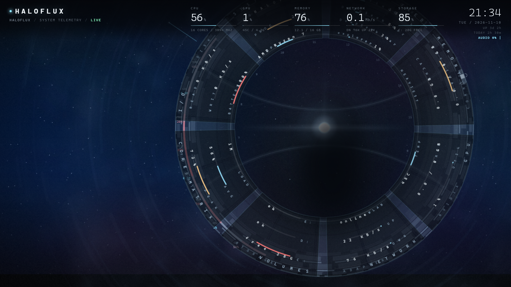

# Haloflux



一个给 Windows 用的桌面动态壁纸 + 屏保程序。

- **桌面壁纸**：一段循环播放的视频铺在图标**下面**，桌面行为完全原生（图标可点、右键菜单、拖拽都不受影响）
- **屏保**：完整 HUD（多层断环、八块扇形数据面板、音乐可视化、粒子流星），带音乐播放器

预览图用的是仓库自带的占位背景（`docs/sample-background.jpg`），不是任何版权素材；
你自己放视频进去后就是你的画面。

## 原理

Windows 11 的桌面由 DirectComposition 合成，**GDI 绘制（无论画进子窗口还是画进桌面 DC）都会被丢弃**。
本项目因此用 `CreateSwapChainForHwnd` 把 D3D11 交换链挂到桌面窗口上，画面才真正进入合成器。
挂载需要进程以普通（Medium）完整性运行，低完整性进程会被系统拒绝（`SetParent` 返回 `ERROR_ACCESS_DENIED`）。

## 构建

需要 .NET 9 SDK 和 Windows 10/11。

```powershell
dotnet build -c Release
```

## 使用

### 桌面壁纸

```powershell
HalofluxDesk.exe --wall
```

常驻方式见下方「让它常驻」。

### 让它常驻

壁纸是普通进程，登录后自动启动即可。三件事一起做就是"永远在"：

```powershell
$exe = "$PWD\bin\Release\net9.0-windows\HalofluxDesk.exe"

# 1. 登录自启
Set-ItemProperty "HKCU:\Software\Microsoft\Windows\CurrentVersion\Run" `
    -Name HalofluxDesk -Value "`"$exe`" --wall"

# 2. 看门狗：每 5 分钟检查一次，进程没了就拉起
schtasks /Create /TN "HalofluxWatchdog" /SC MINUTE /MO 5 `
    /TR "`"$PWD\tools\watchdog.cmd`"" /F
```

程序自己也会修复这些情况：

| 情况 | 行为 |
|---|---|
| 重复启动 | 单实例锁，第二个进程直接退出 |
| Explorer 重启、桌面窗口重建 | 每 3 秒检查宿主窗口，失效就重建交换链 |
| 睡眠唤醒、切换分辨率 | 监听系统事件，自动重建交换链 |
| 崩溃 | 看门狗任务在 5 分钟内拉起 |

内存占用稳定在 300 MB 上下：解码器使用固定缓冲池复用位图，不会随运行时间增长。

### 屏保

把 `bin\Release\net9.0-windows\HalofluxDesk.exe` 复制一份改名为 `Haloflux.scr`，然后在
**设置 → 个性化 → 锁屏界面 → 屏幕保护程序** 里选择它。

屏保运行时：

| 操作 | 效果 |
|---|---|
| 移动鼠标 / 按其他键 | 退出屏保 |
| `←` / `→` | 上一首 / 下一首 |
| `空格` | 暂停 / 继续 |
| `M` | 切换播放模式（顺序 / 单曲循环 / 随机） |
| `↑` / `↓` | 音量 +5% / -5%（会记住，下次启动沿用） |

屏保期间会阻止系统休眠和显示器关闭。

### 完整版（不开屏保也想看 HUD）

```powershell
HalofluxDesk.exe --native
```

## 素材（**不在仓库里**，需要自备）

版权原因，仓库不包含视频和音乐。放置位置：

```
www\media\scene.mp4          背景视频（循环播放）
www\media\bg.jpg             视频抽帧失败时的兜底静帧
www\media\frames\*.jpg       背景帧序列（可选，性能更好）
www\media\music\*.mp3|m4a    播放列表
```

生成帧序列（把 `scene.mp4` 抽成 15fps 的帧）：

```powershell
.\tools\Extract-Frames.ps1 -Video www\media\scene.mp4
```

音乐文件夹支持 `.mp3`、`.m4a`、`.aac`、`.wav`，**丢进去就会被识别**，按文件名排序播放。

## 项目结构

| 文件 | 职责 |
|---|---|
| `Program.cs` | 入口，模式分派（`--wall` / `--native` / `/s` 屏保） |
| `NativeWall.cs` | 所有画面绘制（GDI+） |
| `D3DWall.cs` / `D3DDesk.cs` | D3D11 交换链与帧上传 |
| `MusicPlayer.cs` | 播放列表、m4a 支持、三种播放模式 |
| `ScreensaverForm.cs` | 屏保窗口、按键处理、防休眠 |
| `TrayControl.cs` | 托盘菜单 |
| `Sampler.cs` | CPU / GPU / 内存 / 网络 / 磁盘采样 |
| `AudioProbe.cs` | 环回音频 FFT（32 段） |
| `www/` | 早期 WebView2 版界面（保留作参考） |

## 许可

MIT
